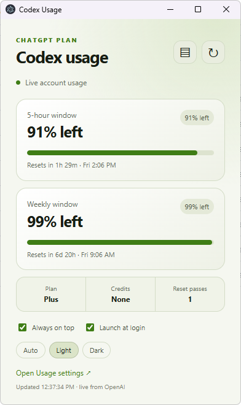
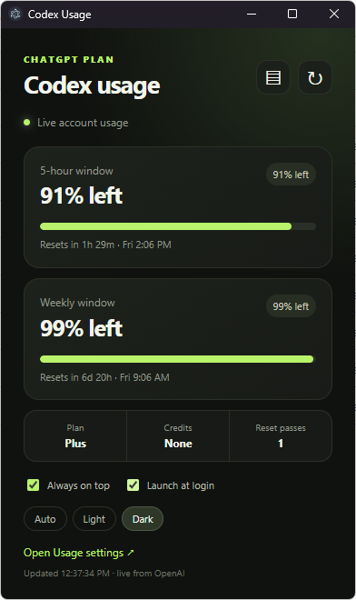
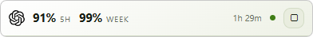
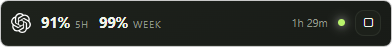

# Codex Usage Widget

A compact desktop widget for the Codex allowance included with a ChatGPT plan. It runs on Windows 11, Linux, and macOS.

The widget asks your locally installed, authenticated Codex CLI for a fresh account-wide usage snapshot. This includes Codex use from other computers. It does not use an API key, scrape browser cookies, or submit an inference prompt.

On Windows 10/11 the recommended build is the native WinUI 3 app in `winui/`. The Electron app stays the macOS and Linux implementation, and the two are kept at feature parity.

## Screenshots

Full widget and mini mode in light and dark themes:

| Light | Dark |
| --- | --- |
|  |  |
|  |  |

## Requirements

- Node.js 24.22.1 or newer (for running from source or building installers)
- .NET SDK 8.0 or newer (only for the native Windows build in `winui/`)
- Codex CLI installed and signed in with ChatGPT (`codex login`)

Packaged desktop installers include Electron's runtime and do not require a separate Node.js installation.

Prefer a Node.js release line that receives security patch releases: the October 21, 2026 release fixed the Brotli decoder flaw in 22.23.4, 24.22.1 and 26.12.1, so use a patched 24.x (24.22.1 or newer) or a patched 26.x (26.12.1 or newer). Node 25.x is an odd release line that never receives those fixes.

## Run locally

With nvm installed, run `nvm install` and `nvm use` to select the version in `.nvmrc`. npm enforces the Node.js requirement during dependency installation.

nvm is only available on macOS and Linux. On Windows, print your version with `node --version`; if it is at least 24.22.1 you can install as is, otherwise pin a supported release with fnm (`fnm use 24.22.1`) or nvm-windows. An `EBADENGINE` error from `npm install` means the version you have is outside the requirement.

```bash
npm install
npm start
```

The app refreshes every minute and can live in the system tray. Set `CODEX_BIN` to the full Codex executable path if `codex` is not on the GUI application's `PATH`.

Hover over the tray icon to see the remaining 5-hour and weekly allowances. The tooltip updates on automatic and manual refreshes, even while the widget is hidden. Offline snapshots are marked as potentially stale, and missing usage is shown as unavailable.

The tray icon is tinted by the remaining allowance in the 5-hour window, so its state is visible at a glance without hovering:

| Remaining | Icon colour |
| --- | --- |
| under 20% | red |
| 20% to under 40% | orange |
| 40% to under 60% | yellow |
| 60% or more | green |

The weekly window never changes the icon colour, and missing usage keeps the neutral lime icon. The colour follows every refresh, including manual refreshes and while the widget is hidden.

`npm run generate:icon` renders these tints: PNGs for the Electron tray go to `src/assets`, and the multi-size `.ico` files the WinUI tray needs go to `winui/assets`. Both are committed, so regenerating them is only needed when the artwork changes.

The tray menu includes Always on top, Light theme, Compact mode, and Open Codex Settings, followed by the usage summary. On Linux, click the icon to open this menu. Ubuntu's GNOME AppIndicator extension does not display hover tooltips; other Linux desktops may support them.

### Mini mode

A compact, frameless strip about the height of a Chrome tab bar (46px) showing both window percentages, the next reset countdown, and a live/stale indicator. Toggle it with the ▤ button, the tray menu, or the ▢ button in the strip; the strip is draggable. The choice is remembered across restarts.

## Native Windows widget (WinUI 3)

`winui/` holds the WinUI 3 (Windows App SDK 1.7) rewrite for Windows 10/11. It is unpackaged and self-contained: no MSIX identity, no bundled browser runtime. Everything the Electron widget does is there — the 60-second refresh, the live read → local snapshot → error chain, mini mode, the tinted tray icon with its tooltip and menu, close-to-tray, single-instance activation, always on top, launch at login, and the Auto / Light / Dark override.

```powershell
# Windows only, and only through Visual Studio's MSBuild (a plain `dotnet build`
# cannot find the Windows App SDK PRI tasks). Open the solution in VS 2022, or:
msbuild winui/CodexUsageWidget.sln -t:Restore -nologo -v:minimal
msbuild winui/CodexUsageWidget.sln -p:Configuration=Release -nologo -v:minimal
winui\src\CodexUsageWidget\bin\Release\net8.0-windows10.0.19041.0\win-x64\CodexUsageWidget.exe
dotnet test winui/tests/CodexUsageWidget.Tests   # shared logic; runs on any OS
```

The platform-free half — the Codex `app-server` client, usage normalization, the offline snapshot, tray tint and tooltip text, settings persistence, and launch at login — lives in `winui/src/CodexUsageWidget.Core` and is unit-tested there. `CODEX_BIN` and `CODEX_HOME` work exactly as they do for the Electron app, and the settings files (`widget-mode.json`, `widget-theme.json`) sit under `%LOCALAPPDATA%\CodexUsageWidget`.

Windows-specific choices worth knowing:

- Launch at login writes a `CodexUsageWidget` value under `HKCU\Software\Microsoft\Windows\CurrentVersion\Run`; an unpackaged app has no startup task to enable.
- The tray icon and menu are plain Win32 (`Shell_NotifyIcon` plus `TrackPopupMenu`). The Windows App SDK ships no tray type, and pulling WinForms into a WinUI project drags the WPF targets in with it.
- That menu is rebuilt each time it opens, so its checkmarks always match the widget.
- Closing the window hides it to the tray; Quit in the tray menu is the way out.
- The window grows to fit wrapped footer text, capped at the desktop work area, and never shrinks below a size you set yourself.

## Light and dark mode

The widget follows your OS theme by default. Use the Auto / Light / Dark control in the footer to override it; the choice is remembered between launches. Overriding the theme also affects native window chrome, and the palette swaps instantly with no reload.

### Linux sandbox setup

Ubuntu may block Chromium's user-namespace sandbox. For a development or unpacked build, configure Electron's sandbox helper once:

```bash
npm run fix:linux-sandbox
```

The guarded script changes only the two known `chrome-sandbox` files inside this project to owner `root:root` and mode `4755`. It requires `sudo`. Do not work around this with `--no-sandbox`.

## Build installers

Build on each target operating system for the most reliable native package:

```bash
npm run build:win
npm run build:mac
npm run build:linux
```

Artifacts are written to `dist/`.

The native Windows widget is built separately, on Windows, with Inno Setup installed:

```powershell
msbuild winui/src/CodexUsageWidget/CodexUsageWidget.csproj -t:Restore -nologo -v:minimal
msbuild winui/src/CodexUsageWidget/CodexUsageWidget.csproj -t:Publish -p:Configuration=Release `
  -p:RuntimeIdentifier=win-x64 -p:SelfContained=true -p:PublishDir=$PWD\winui\publish\ -nologo -v:minimal
& "C:\Program Files (x86)\Inno Setup 6\ISCC.exe" winui/installer/setup.iss
```

The installer lands in `winui/installer/Output/`. Pass `//DAppVersion=0.2.0` to ISCC to label it with the release version.

## Continuous integration and releases

Two GitHub Actions workflows drive the pipeline:

- `.github/workflows/ci.yml` runs the Electron unit tests on `ubuntu-24.04` and `windows-latest`, and builds the whole `winui/` solution plus its tests on `windows-latest`, for every push to `master` and every pull request.
- `.github/workflows/release.yml` builds Linux (`AppImage` + `deb`) and Windows (`NSIS setup` + `portable`) on their native runners, publishes the native WinUI 3 widget installer from the same Windows runner, then attaches all of them to a GitHub Release.

### Version handling

The git tag decides the release version: pushing `v0.2.0` publishes `0.2.0`, and the AppImage, the `.deb`, and the Windows installers (including their file properties) are labeled `0.2.0`. `package.json` does not have to be bumped first - the workflow rewrites the version in its own checkout before building and emits a warning so you can commit the bump afterwards. Versions must look like `X.Y.Z` or `X.Y.Z-prerelease`; a version containing `-` is published as a GitHub prerelease.

Ship a release by bumping and tagging in one commit:

```bash
npm version 0.2.0
git commit -am "Release 0.2.0"
git tag v0.2.0
git push origin master --tags
```

Re-running an existing tag stops instead of overwriting a published release. To repair one, run the Release workflow manually with `force` checked. A manual run also takes an explicit `version` input and creates that tag at the commit it runs on.

Installers are unsigned: no code-signing identity or macOS notarization is configured, so SmartScreen warns on first run. macOS packages are not published; add a matrix entry with `macos-latest` and `build:mac` if you want them.

## Privacy and behavior

The app launches `codex app-server --stdio` and calls the read-only `account/rateLimits/read` method. Credentials remain managed by Codex. No conversation is started, and the app never reads or stores your authentication tokens.

If the live read is unavailable, the widget displays the newest rate-limit snapshot from local Codex session events and clearly labels it as potentially stale.
